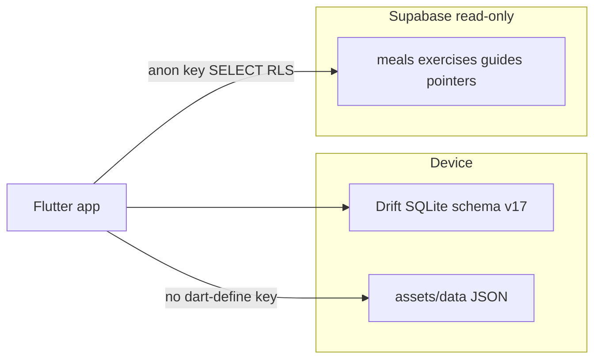

# The Muscle Builder — Agent & workflow handbook

**Read this first** when starting a fresh AI session or onboarding to the repo. This file has **no secrets** (only placeholders and secret *names*). Real keys live in **gitignored** `.env.local` and GitHub Actions secrets.

## Companion docs

| Doc | Purpose |
| --- | --- |
| [README.md](../README.md) | Product overview, features, signing setup |
| [docs/SECURITY.md](SECURITY.md) | Keys, RLS, what never ships in the app |
| [supabase/README.md](../supabase/README.md) | Reference tables, migrations, upsert |
| [supabase/seed/README.md](../supabase/seed/README.md) | Manual SQL seeds for exercises |

**Hard rules for agents**

- Never commit `.env.local`, `service_role` keys, keystores, or `android/key.properties`.
- Never `git push` to `main` unless the user explicitly asked.
- Do not toggle Android `builtInKotlin` / `kotlinOptions` without reading [Android CI guardrails](#android-ci-guardrails) below.

---

## Architecture: device vs cloud

### Local Drift (personal data)

- **Source:** [`lib/data/db/app_database.dart`](../lib/data/db/app_database.dart)
- **Schema version:** 17 (bump `schemaVersion` + migration steps when changing tables)
- **Stores:** profile, workouts, check-ins, metrics, hydration, meal log entries, custom foods, custom routines, and related user state
- **Never** synced to Supabase in the current design — device-only

### Supabase (reference catalogs only)

- **Init:** [`lib/main.dart`](../lib/main.dart) when `AppConstants.hasSupabaseKey` (`--dart-define=SUPABASE_ANON_KEY=...`)
- **Tables:** `meals`, `exercises`, `food_pharmer_pointers`, `pro_nutrition_guides`
- **Client access:** SELECT only, `is_deleted = false` (see migration 002 in [`supabase/migrations/`](../supabase/migrations/))
- **Writes:** Supabase SQL Editor, Management API, or [`scripts/upsert_reference_data.py`](../scripts/upsert_reference_data.py) with **service_role** in `.env.local` only — not in the Flutter app
- **User meals / custom foods:** local Drift only; not Supabase

### Reference catalog source (meals + exercises)

| Build | Source |
| --- | --- |
| `SUPABASE_ANON_KEY` set at run/build | **Supabase only** (`meals`, `exercises` tables) — no silent JSON fallback |
| No key (CI unit tests, default `flutter test`) | Bundled `assets/data/meals.json`, `exercises.json` |

JSON files remain in the repo as **seed generation source** (`scripts/generate_*_upsert_sql.py`), not runtime truth when a key is set.

### Other bundled data

- `assets/data/foods.json` — meal-log autocomplete (local Drift merge); not Supabase
- Guides: Dart const lists + Supabase `food_pharmer_pointers` / `pro_nutrition_guides`

### Reference catalog sync (remote)

1. Run migrations: `001` → `002` → `003` → `004` (see [`supabase/migrations/`](../supabase/migrations/))
2. SQL Editor: [`supabase/seed/000_run_once_prerequisite_columns.sql`](../supabase/seed/000_run_once_prerequisite_columns.sql) if needed
3. Full seed: [`meals_upsert.sql`](../supabase/seed/meals_upsert.sql) (58) + [`exercises_upsert_full.sql`](../supabase/seed/exercises_upsert_full.sql) (88)
4. Or: `python3 scripts/upsert_reference_data.py --tables meals,exercises`
5. Regenerate SQL: `generate_meals_upsert_sql.py`, `generate_exercises_upsert_sql.py`

### Authentication vs reference data (FAQ)

- **User sign-in is not required** for meals, exercises, or guides. The app uses the **publishable anon key** (`SUPABASE_ANON_KEY`) to `SELECT` reference rows under RLS.
- **With the key set** and tables seeded: meals and exercises come **only from Supabase** (not bundled JSON). Personal data (profile, logs, workouts) stays in **Drift** on device.
- **Without the key** (`flutter test`, CI): meals and exercises use **`assets/data/*.json`** only.
- **Guides** (`food_pharmer_pointers`, `pro_nutrition_guides`): Supabase first; **Dart const fallbacks** in [`lib/data/seed/pro_nutrition_guides.dart`](../lib/data/seed/pro_nutrition_guides.dart) if Supabase is empty or errors.
- Future per-user cloud sync would need auth; that is **not** implemented today.

### Soft-delete catalog rows

Applies to `meals`, `exercises`, `food_pharmer_pointers`, `pro_nutrition_guides` (migration [`002_is_deleted_and_security.sql`](../supabase/migrations/002_is_deleted_and_security.sql)).

| Action | How |
| --- | --- |
| Hide from app | Supabase SQL Editor: `UPDATE meals SET is_deleted = true, updated_at = now() WHERE id = '…';` |
| Restore | `SET is_deleted = false, updated_at = now()` |
| Client | [`SeedRepository`](../lib/data/repositories/seed_repository.dart) filters `.eq('is_deleted', false)`; RLS also enforces non-deleted rows |
| Re-seed from JSON | Upsert SQL / `upsert_reference_data.py` **preserves** existing `is_deleted` on conflict |
| Refresh UI | [`ReferenceCatalogLifecycle`](../lib/app/reference_catalog_lifecycle.dart) on app resume; pull-to-refresh on Nutrition meal lists |

**Offline JSON** (`meals.json` / `exercises.json`) has no soft-delete — hiding rows is a **Supabase-only** admin operation.

---

## Environment and workflows

| Task | How |
| --- | --- |
| Copy env template | [`.env.example`](../.env.example) → `.env.local` (gitignored) |
| Local Flutter + Supabase | `./scripts/flutter_run_local.sh` or `./scripts/flutter_run_local.sh -d macos` |
| Manual dart-define | `flutter run --dart-define=SUPABASE_ANON_KEY=<publishable-key>` |
| Upsert reference data | `python3 scripts/upsert_reference_data.py` / `--tables exercises` |
| Tests / analyze | `flutter test`, `dart analyze` |
| Android/iOS CI | [`.github/workflows/mobile-builds.yml`](../.github/workflows/mobile-builds.yml) |

### GitHub Actions (Android)

- **Java 21** (Temurin) — required for stable AGP 9 lint/tooling
- Optional secret: `SUPABASE_ANON_KEY` (publishable/anon only)
- Build number: `github.run_number`
- Signing: `ANDROID_KEYSTORE_*` secrets; without keystore, release uses debug signing

### macOS dev pitfalls

- **Fox + text fields:** meal log uses `idleMascotHostBridgeProvider` to close fox chat on field focus ([`meal_log_screen.dart`](../lib/features/nutrition/meal_log_screen.dart))
- **Keyboard assert (`KeyDownEvent` / Space):** often from `flutter attach` + terminal key injection; **quit** `flutter run` and start clean — do not assume DB/Supabase bugs
- Prefer `./scripts/flutter_run_local.sh -d macos` for local `.env.local` mapping

---

## Android CI guardrails

Stable configuration after multiple CI failures. **Do not “simplify” Gradle without reading this.**

| Setting | File | Value / rule |
| --- | --- | --- |
| AGP / Gradle / KGP | [`android/settings.gradle.kts`](../android/settings.gradle.kts) | 9.3.1 / wrapper 9.5 / Kotlin 2.4.20 |
| Built-in Kotlin | [`android/gradle.properties`](../android/gradle.properties) | **`android.builtInKotlin=false`** until every Flutter plugin drops `kotlin-android` |
| New DSL opt-out | `gradle.properties` | `android.newDsl=false` (best effort; CI may still analyze scripts strictly) |
| App module | [`android/app/build.gradle.kts`](../android/app/build.gradle.kts) | `kotlin-android` + **`kotlin { compilerOptions { jvmTarget = JVM_17 } }`** |
| App release lint | `app/build.gradle.kts` | `lint { checkReleaseBuilds = false }` |
| Plugin release lint | [`android/build.gradle.kts`](../android/build.gradle.kts) | `afterEvaluate` → disable tasks named `lintVital*` |

### Do not

1. Set **`android.builtInKotlin=true`** while plugins (`shared_preferences_android`, `url_launcher_android`, `video_player_android`, etc.) still apply `kotlin-android` — entire graph fails.
2. Re-add **`kotlinOptions { jvmTarget = ... }`** inside `android { }` — AGP 9 + new DSL treats this as a **script compile error** on CI.
3. Configure lint in **root** `build.gradle.kts` with deprecated `com.android.build.gradle.AppExtension` / `LibraryExtension` — **Unresolved reference** on CI.
4. “Fix” lint by re-enabling **`lintVitalAnalyzeRelease`** on plugins without JDK 21 and without understanding AGP lint bugs.

### Failure chain (short RCA for future you)

1. AGP below Flutter minimum → bump AGP/Gradle.
2. `kotlinOptions` on app → script errors when new DSL is active.
3. `builtInKotlin=true` → plugin `kotlin-android` rejected.
4. `builtInKotlin=false` + compilerOptions → Kotlin OK; then plugin **lintVital** crashed on JDK 17.
5. Broken root lint DSL → Gradle never compiled; fix = **task-based** `lintVital` disable + Java 21.

Reference: [Flutter built-in Kotlin](https://docs.flutter.dev/release/breaking-changes/migrate-to-built-in-kotlin/for-app-developers)

---

## Typography and UI style

**Source of truth:** [`lib/core/theme/app_theme.dart`](../lib/core/theme/app_theme.dart), [`lib/core/theme/design_tokens.dart`](../lib/core/theme/design_tokens.dart)

### Font roles (Google Fonts)

| Role | Family | Weights | Used for |
| --- | --- | --- | --- |
| Display | **Barlow Semi Condensed** | 600–700 | `display*`, `headline*`, `titleLarge` — screen titles, hero |
| Body | **Source Sans 3** | 400, 600 | `body*`, most `titleMedium` / `labelLarge` — paragraphs, UI copy |
| Meta | **IBM Plex Mono** | 500 | `labelMedium`, `labelSmall`, bottom nav labels — stats, chips, meta |

### Color and layout

- **Material 3** (`useMaterial3: true`)
- **Accent:** user-chosen in profile; default `AppColors.defaultAccent` (`0xFFFF6B35`)
- **Neutrals:** `AppNeutrals` + `AppCraftColors` theme extension — warm dark canvas (`#0C0C0B`), no `ColorScheme.fromSeed` purple bleed
- **Compact density:** `VisualDensity.compact` in theme

### When adding UI

- Prefer `Theme.of(context).textTheme` and `Theme.of(context).extension<AppCraftColors>()`
- Avoid one-off `GoogleFonts.*` except where the codebase already does (e.g. exercise gallery)
- Match existing spacing/borders from `design_tokens.dart`

---

## Feature map (quick paths)

| Area | Key files |
| --- | --- |
| Routing / shell | [`lib/app/router.dart`](../lib/app/router.dart), [`lib/app/app.dart`](../lib/app/app.dart) |
| Riverpod | [`lib/app/providers.dart`](../lib/app/providers.dart) |
| Fox mascot | [`lib/core/widgets/idle_mascot_host.dart`](../lib/core/widgets/idle_mascot_host.dart), `idleMascotHostBridgeProvider`, Profile toggle `idleMascotEnabledProvider` |
| Meal log / foods | [`lib/features/nutrition/meal_log_screen.dart`](../lib/features/nutrition/meal_log_screen.dart), `FoodCatalog`, `assets/data/foods.json`, Drift `custom_food_items` |
| Exercises | `ExerciseCatalog`, Supabase or `exercises.json`, `demo_frames` / posture gallery |
| Custom routines | [`lib/data/repositories/custom_routine_repository.dart`](../lib/data/repositories/custom_routine_repository.dart) |

---

## Repo hygiene

- **Commits:** only when the user asks; follow existing message style.
- **Secrets in CI:** publishable anon key only in `SUPABASE_ANON_KEY`; service_role never in workflows.
- **Drift schema:** after table changes, increment version and ship a migration; run `flutter test`.
- **Supabase:** client seeds disabled; use SQL seeds under `supabase/seed/` or upsert script.

---

*Last updated for AGP 9.3 / Flutter stable CI lane and Drift schema v17. Amend this file when architecture or Android policy changes.*